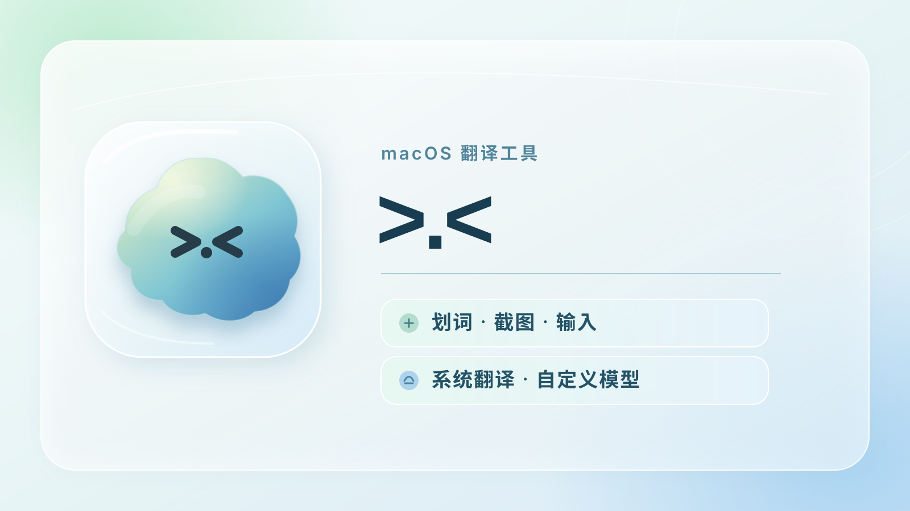

# >.<

>.< 是一款轻量的 macOS 中英翻译工具。选中文字、框选屏幕或直接输入，译文都会显示在桌面浮窗中。可使用苹果系统翻译，也可接入 DeepSeek 或自定义模型服务。

## 看看效果

翻译浮窗可切换语言方向、复制译文并保持置顶；历史记录和收藏保存在本机。


在服务设置中选择苹果系统翻译、DeepSeek 或支持 OpenAI Chat Completions 格式的接口。


## 怎么使用

| 操作 | 默认快捷键 | 说明 |
| --- | --- | --- |
| 划词翻译 | Control + D | 在其他应用中选中文字后按快捷键 |
| 截图翻译 | Control + S | 框选区域，本机识别文字后翻译；Esc 取消 |
| 输入翻译 | Control + A | 输入文字后按 Enter 翻译，Shift + Enter 换行 |

关闭窗口后，快捷键仍可使用；点击 Dock 图标可重新打开窗口。按 **Command + Q** 退出。

## 下载安装

从 [Releases](https://github.com/MN0709/OvO/releases/latest) 下载 `OvO-1.0.0-macOS-arm64.zip`，解压后将 `>.<.app` 拖入「应用程序」并打开。安装包适用于 Apple Silicon（M 系列）Mac，要求 macOS 14 或更高版本；苹果系统翻译需要 macOS 15 或更高版本。Intel Mac 尚未验证。

安装包使用本机开发证书签名，**未经 Apple 公证**。如果首次打开被 macOS 拦截，请先尝试打开一次，再按 [Apple 的说明](https://support.apple.com/zh-cn/102445) 在「系统设置 → 隐私与安全性」中选择「仍要打开」。无需关闭系统安全保护。

## 从源码运行

需要 macOS 14 或更高版本，以及带有 macOS 15 或更新 SDK 的 Swift 6 工具链。苹果系统翻译需要 macOS 15 或更高版本；macOS 14 可配置 DeepSeek 或自定义 API。

```sh
git clone https://github.com/MN0709/OvO.git
cd OvO
./scripts/build-app.sh
open 'dist/>.<.app'
```

构建脚本会在本机生成开发签名。构建细节见 [开发说明](docs/DEVELOPMENT.md)。

## 服务与数据

| 项目 | 说明 |
| --- | --- |
| 苹果系统翻译 | macOS 15+，无需 API Key；首次使用可能需要下载中英文语言包 |
| DeepSeek / 自定义 API | 在应用内填写服务配置；费用由所选服务商决定 |
| 划词 / 截图权限 | 按 macOS 提示授予辅助功能或屏幕录制权限；仅输入翻译无需这两项权限 |
| API Key | 保存在 macOS 钥匙串中 |
| 历史与收藏 | 只保存在本机，可在应用内关闭自动保存或删除记录 |

截图文字由 Apple Vision 在本机识别。使用远程模型服务时，待翻译文字会发送到你配置的服务地址；使用苹果系统翻译时不需要模型 API。自定义 API 支持兼容 OpenAI Chat Completions 的 HTTPS 服务，以及本机 HTTP 服务。

## 开发与反馈

运行 `./scripts/test.sh` 执行测试。欢迎在 [Issues](https://github.com/MN0709/OvO/issues) 反馈问题；请附上 macOS 版本、芯片型号和复现步骤，避免上传密钥或私人翻译内容。

源码采用 [MIT License](LICENSE)。
